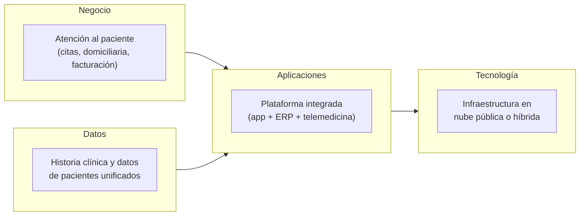

# Documento de Visión de Arquitectura

_Ejemplo de clase: el contenido sale de la guía paso a paso (sección B.2)._

## Cliente
Fundación Salud Viva

## Integrantes del equipo
- Equipo de ejemplo (caso de clase)

## Mapa conceptual de alto nivel

## Beneficios esperados

Cada fila debe conectar un objetivo estratégico de la Ficha de Caracterización con un beneficio concreto y medible.

| Objetivo estratégico (Ficha) | Beneficio esperado | Cómo se mide |
|---|---|---|
| Mejorar eficiencia operativa | Menos tiempo administrativo por paciente al integrar app, ERP y telemedicina | Minutos promedio de atención por paciente |
| Ampliar cobertura nacional | La plataforma soporta más usuarios sin duplicar infraestructura por ciudad | Costo operativo por usuario activo |
| Cumplir normativas de datos clínicos | Datos de pacientes con control de acceso y trazabilidad centralizados | Resultado del checklist normativo (Taller 6) |

## Alcance

| En alcance | Fuera de alcance |
|---|---|
| Integración de app móvil, ERP y telemedicina | Reemplazo de Google Workspace (restricción de la Ficha) |
| Arquitectura de datos unificada de pacientes | Migración fuera de nube pública/híbrida |
| Documentación formal de la arquitectura actual y objetivo | Implementación real del sistema (el curso entrega el diseño, no lo construye) |

## Capacidades de negocio (borrador)

| Capacidad (verbo + objeto) | Proceso(s) de la Ficha que la realizan | Soporte tecnológico hoy (alto / medio / bajo) | Evidencia (qué dijo o mostró el cliente) |
|---|---|---|---|
| Agendar y gestionar citas | Gestión de citas y agendamiento médico | Alto | La app móvil agenda y notifica; el cliente no reporta fallas en este flujo |
| Atender pacientes a domicilio | Atención médica domiciliaria | Medio | Las visitas se programan en la app, pero el registro clínico se hace en formularios de Google Workspace |
| Hacer seguimiento remoto al paciente | Seguimiento remoto (telemedicina) | Medio | La plataforma de telemedicina funciona, pero no comparte datos con la app ni con el ERP |
| Mantener una historia clínica unificada | Transversal: citas, domiciliaria y telemedicina | Bajo | Problema #1 de la Ficha: la información del paciente vive en tres sistemas que no se hablan |
| Facturar a aseguradoras | Gestión administrativa y facturación | Medio | El ERP factura, pero los soportes clínicos se recopilan a mano desde los otros dos sistemas |
| Reportar la operación a la dirección | Transversal | Bajo | Problema #2 de la Ficha: no se pueden generar reportes integrales de pacientes y procesos |

## Principios arquitectónicos (borrador)

| Principio (nombre) | Declaración | Implicación (qué descarta) | Sale de (objetivo o restricción de la Ficha) |
|---|---|---|---|
| Historia clínica única | Cada dato clínico del paciente se captura una sola vez y tiene un sistema dueño; los demás lo consultan, no lo copian. | Descarta que la app, el ERP o la telemedicina guarden su propia versión del paciente; cualquier componente nuevo que duplique datos clínicos necesita una excepción aprobada. | Objetivo 1 (eficiencia operativa) y problema #1 (falta de integración) |
| Integración por servicios, no por archivos | Los sistemas se conectan por interfaces documentadas y versionadas, nunca por exportaciones manuales ni archivos compartidos. | Descarta el intercambio de hojas de cálculo entre app, ERP y telemedicina; encarece cualquier integración que no exponga una interfaz. | Objetivo 2 (cobertura nacional sin duplicar costos) |
| Nube pública o híbrida por defecto | Todo componente nuevo se despliega en nube pública o híbrida; Google Workspace y Zoho One no se reemplazan en 2026. | Descarta servidores propios en cada ciudad y descarta migrar el ERP o la ofimática este año. | Restricciones de la Ficha (sección V) |

## Justificación

La visión responde a los tres objetivos estratégicos de la Ficha. La integración de la app, el ERP y la telemedicina ataca directamente el problema #1 y el objetivo de eficiencia operativa; la arquitectura de datos unificada permite los reportes integrales que hoy no existen (problema #2) y el control de acceso que exige el objetivo de cumplimiento normativo.

El alcance respeta las restricciones declaradas por el cliente: Google Workspace se mantiene y toda la solución se plantea en nube pública o híbrida, lo que además soporta el objetivo de ampliar la cobertura nacional sin duplicar infraestructura por ciudad.

---

_Este documento hace parte de la entrega del Taller 0 del curso AREM (Arquitectura Empresarial) - Universidad de La Sabana._
