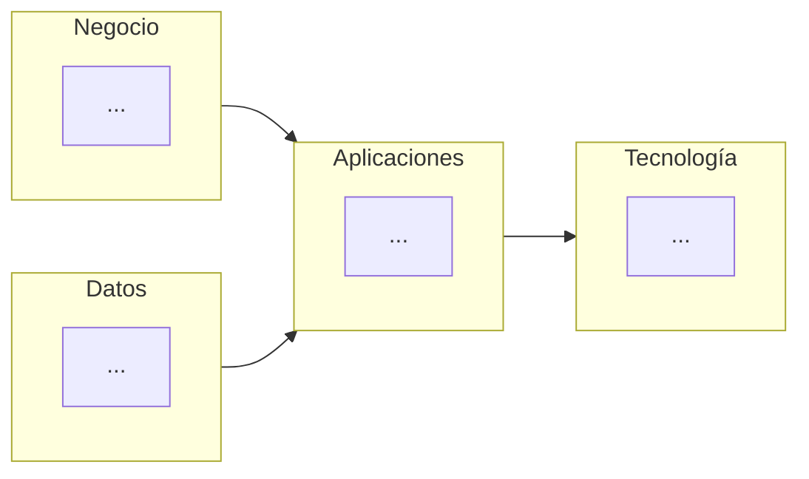

# Documento de Visión de Arquitectura

## Cliente
_Nombre del cliente real._

## Integrantes del equipo
- Nombre 1 (correo o usuario GitHub)
- Nombre 2
- Nombre 3

## Mapa conceptual de alto nivel

> Represente 4 a 6 cajas grandes (negocio, datos, aplicaciones, tecnología) — sin el nivel de detalle de un BPMN o un C4, ese trabajo llega en los Talleres 1 a 4. Puede usar un diagrama Mermaid (se renderiza en GitHub) o una imagen/boceto.

## Beneficios esperados

Cada fila debe conectar un objetivo estratégico de la Ficha de Caracterización con un beneficio concreto y medible.

| Objetivo estratégico (Ficha) | Beneficio esperado | Cómo se mide |
|---|---|---|
| | | |
| | | |
| | | |

## Alcance

| En alcance | Fuera de alcance |
|---|---|
| | |
| | |

## Capacidades de negocio (borrador)

> Una capacidad es lo que la organización necesita saber hacer, escrita con verbo + objeto y sin nombrar tecnología («Agendar citas», no «Sistema de citas»). Salen de los procesos clave de la Ficha (sección IV): un proceso realiza una capacidad, y una capacidad puede necesitar varios procesos. Liste de 5 a 8 y valore cuánto la soporta hoy la tecnología que el cliente ya tiene. Esta lista es la que el Taller 7 (sección 4.1 de su guía) madura y convierte en paquetes de trabajo; allá se ajusta, no se inventa de nuevo.

| Capacidad (verbo + objeto) | Proceso(s) de la Ficha que la realizan | Soporte tecnológico hoy (alto / medio / bajo) | Evidencia (qué dijo o mostró el cliente) |
|---|---|---|---|
| | | | |
| | | | |
| | | | |
| | | | |
| | | | |

## Principios arquitectónicos (borrador)

> Un principio es una regla que permite decir «no» a algo concreto. Escriba 3, cada uno con nombre, declaración (una frase) e implicación (qué queda prohibido o más caro). Cada uno sale de un objetivo estratégico o de una restricción de la Ficha. En el Taller 9 (plan de gobernanza) se confirman, se reescriben o se retiran los que el proyecto contradijo, y ahí se agrega la justificación con la evidencia de los Talleres 1 a 8.

| Principio (nombre) | Declaración | Implicación (qué descarta) | Sale de (objetivo o restricción de la Ficha) |
|---|---|---|---|
| | | | |
| | | | |
| | | | |

## Justificación

Explique en 2-3 párrafos por qué esta visión responde a los objetivos estratégicos y problemas identificados en la Ficha de Caracterización, y cómo se relaciona con las restricciones declaradas por el cliente.

---

_Este documento hace parte de la entrega del Taller 0 del curso AREM (Arquitectura Empresarial) - Universidad de La Sabana._
